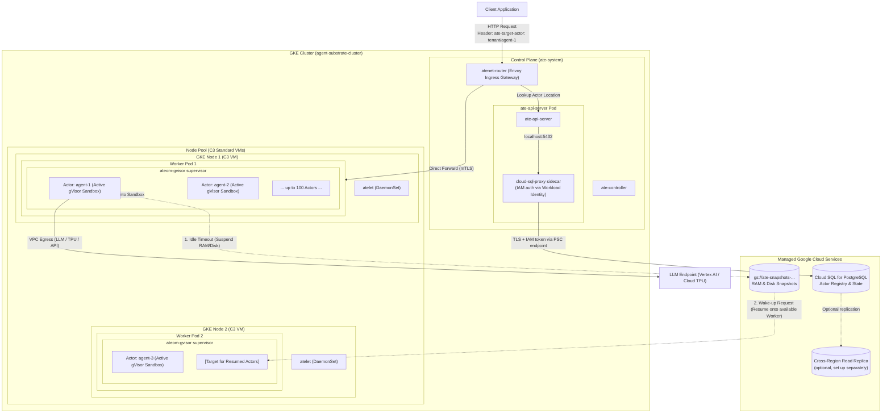
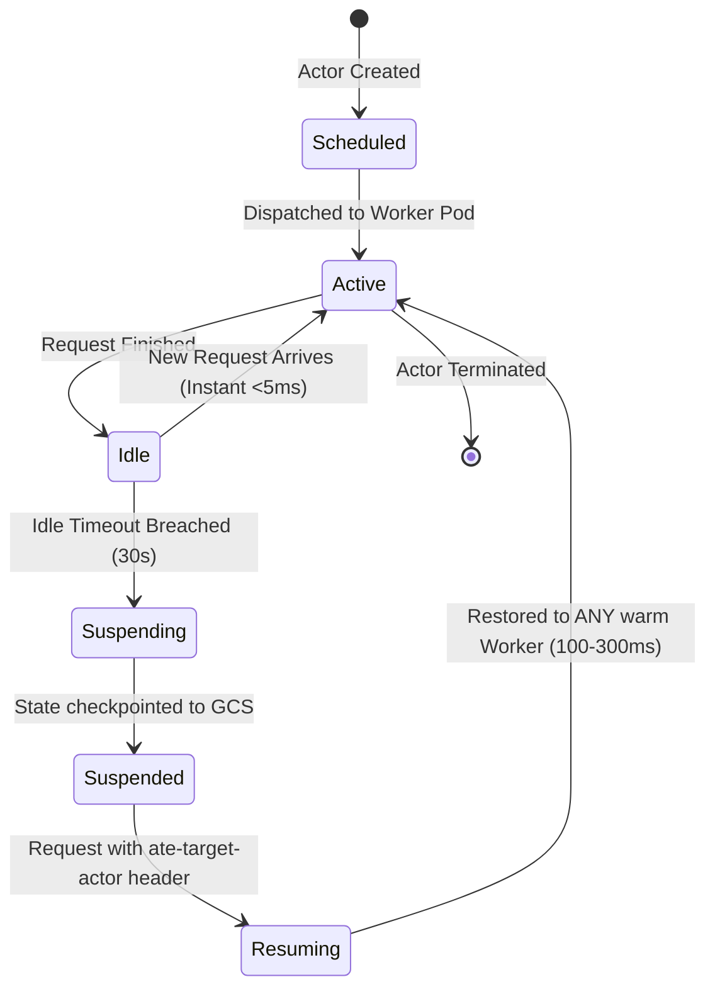

# Agent Substrate on Google Kubernetes Engine (GKE)

A comprehensive, production-grade guide, architecture reference, and manifest repository for deploying and operating **Agent Substrate on Google Kubernetes Engine (GKE)**.

[](LICENSE)
[](https://kubernetes.io/)
[](https://cloud.google.com/kubernetes-engine)
[-009688)](https://gvisor.dev/)

---

## Table of Contents
1. [What is Agent Substrate?](#what-is-agent-substrate)
2. [Why Not Just Run 1 Agent per Pod?](#why-not-just-run-1-agent-per-pod)
3. [Core Concepts & Resource Hierarchy](#core-concepts--resource-hierarchy)
4. [Architecture & Request Flow](#architecture--request-flow)
5. [Prerequisites](#prerequisites)
6. [State Store Architecture: In-Cluster PostgreSQL vs. Cloud SQL](#state-store-architecture-in-cluster-postgresql-vs-cloud-sql)
   - [When to Use In-Cluster PostgreSQL (Local / Dev)](#when-to-use-in-cluster-postgresql-local--dev)
   - [When to Use Cloud SQL for PostgreSQL (Enterprise Production & DR)](#when-to-use-cloud-sql-for-postgresql-enterprise-production--dr)
7. [Step-by-Step GKE Deployment](#step-by-step-gke-deployment)
   - [Phase 1: VPC, Subnet & Cloud NAT](#phase-1-vpc-subnet--cloud-nat)
   - [Phase 2: Private GKE Cluster](#phase-2-private-gke-cluster)
   - [Phase 3: Snapshot Bucket, Image Registry & Workload Identity](#phase-3-snapshot-bucket-image-registry--workload-identity)
   - [Phase 4: Install Agent Substrate (choose a state store)](#phase-4-install-agent-substrate-choose-a-state-store)
   - [Phase 5: Verify with the Counter Demo](#phase-5-verify-with-the-counter-demo)
8. [Suspend & Resume Lifecycle](#suspend--resume-lifecycle)
9. [Scaling & Sizing Formula](#scaling--sizing-formula)
10. [AI Tool Mesh & MCP Governance (Istio Ambient)](#ai-tool-mesh--mcp-governance-istio-ambient)
11. [Production Best Practices & Pitfalls](#production-best-practices--pitfalls)
12. [Troubleshooting & Verification](#troubleshooting--verification)

---

## What is Agent Substrate?

**Agent Substrate** is a purpose-built agent execution runtime designed to run millions of stateful AI agent sandboxes with **10x to 30x higher density** than standard container runtimes.

AI agents behave very differently from traditional web services:
- **Bursty & I/O-Bound**: Agents spend 90%+ of their lifecycle waiting for LLM completions, human-in-the-loop approvals, or tool I/O.
- **Stateful Sessions**: Agents hold conversation history, tool caches, and filesystem artifacts in local RAM and scratch disks.
- **Security Sandboxing**: Agents generate and execute untrusted code (Python, Bash, SQL) requiring zero-trust kernel isolation.

Substrate bridges the gap between **Kubernetes infrastructure orchestration** and **high-density serverless micro-execution** by dynamically bin-packing hundreds of isolated gVisor (`runsc`) agent sessions ("Actors") inside warm Kubernetes Pods ("Workers").

---

## Why Not Just Run 1 Agent per Pod?

| Dimension | 1 Agent = 1 Pod (Traditional K8s) | Agent Substrate (Actors inside Worker Pods) |
| :--- | :--- | :--- |
| **Startup / Resume Latency** | **5 – 30 seconds** (Scheduling, CNI IP assignment, image pulls) | **100 – 300 milliseconds** (Workers already warm; starts sandbox process) |
| **Cluster Limits** | **Hard ceiling at 15,000 – 30,000 Pods** (etcd, kube-proxy, IPAM exhaustion) | **100,000+ to 500,000 active agents** (K8s only sees worker pool pods) |
| **Idle Cost** | **High** (Idle pods hold reserved RAM/CPU or terminate completely) | **Near zero** (Idle actors hibernate their RAM/disk snapshots to GCS) |
| **State Mobility** | **Difficult** (State locked to Pod PVC; migration requires volume re-attachment) | **Instant Teleport** (Actors resume onto *any* available worker in milliseconds) |
| **Security Isolation** | Relies on namespace or standard runc container isolation | **Kernel-level gVisor (`runsc`) sandbox** with virtualized syscalls |

---

## Core Concepts & Resource Hierarchy

Understanding the relationship between Kubernetes primitives and Substrate primitives is essential:

```
GKE Cluster
 └── Node Pool (Compute Engine VMs, e.g. C3 Sapphire Rapids)
      └── ComputeClass (Governs VM family, Shielded VM, labels)
           └── WorkerPool CRD (Manages fleet of Worker Pods)
                └── Worker (A standard Kubernetes Pod running ateom-gvisor)
                     └── In-Pod Base Container (Runtime supervisor)
                          ├── Actor 1 (gVisor runsc sandbox: Python/Tool session)
                          ├── Actor 2 (gVisor runsc sandbox: Bash session)
                          └── ... up to 100+ Actors bin-packed per Worker
```

### Definitions:
* **`Atespace`**: A multi-tenant administrative boundary or tenant workspace (analogous to a Kubernetes namespace, but for agents).
* **`ActorTemplate`**: Defines the blueprint for an agent — container base image, memory/CPU quotas, environment variables, and idle hibernation timeouts.
* **`Actor`**: A live, stateful instance of an agent running in its own gVisor sandbox.
* **`Worker`**: A single Kubernetes Pod running the `ateom-gvisor` daemon. It hosts multiple Actors simultaneously.
* **`WorkerPool`**: A Kubernetes Custom Resource that scales and manages identical Worker Pod replicas across nodes.
* **`EgressPolicy`**: Granular network policy restricting or allowing actor outbound connectivity (e.g. to Vertex AI, Cloud TPUs, or external APIs).

---

## Architecture & Request Flow



---

## Prerequisites

Before starting, ensure you have:
1. **Google Cloud SDK (`gcloud`)**, recent enough for `--enable-dns-access` and `--dns-endpoint` on GKE clusters.
2. **`kubectl`** (1.36 or later).
3. **Go 1.27+** and **Docker with the buildx plugin**: the upstream installer builds Agent Substrate's images from source.
4. GCP IAM permissions to create VPCs, GKE clusters, Cloud Storage buckets, Artifact Registry repositories and IAM bindings (for Option B also Cloud SQL, Cloud DNS and service accounts).
5. A GCP project with billing enabled and the following APIs activated:
   ```bash
   gcloud services enable \
     container.googleapis.com \
     compute.googleapis.com \
     storage.googleapis.com \
     artifactregistry.googleapis.com \
     iam.googleapis.com
   ```

---

## State Store Architecture: In-Cluster PostgreSQL vs. Cloud SQL

Agent Substrate relies on a relational state store (`ate-api-server` metadata repository) to track Actor lifecycle states (`Running`, `Suspended`, `Terminated`), active session-to-worker placements, snapshot URIs, and resource accounting.

Substrate supports two operational topologies for this database:

| Feature / Dimension | In-Cluster PostgreSQL (Default Helm/Manifest) | Cloud SQL for PostgreSQL (Enterprise Production) |
| :--- | :--- | :--- |
| **Topology** | Runs inside GKE cluster as a `StatefulSet` with PVC | Managed GCP Service external to GKE cluster |
| **Authentication** | Password or mTLS certs projected via K8s secrets | **Zero-Trust IAM Database Authentication** (no passwords) |
| **High Availability** | Pod restarts / Kubernetes node rescheduling | Optional **Regional HA** (`AVAILABILITY_TYPE=REGIONAL`) with automatic zonal failover |
| **Multi-Region Disaster Recovery** | ❌ **Extremely Difficult**: State trapped on local cluster PVC | Possible with **Cross-Region Read Replicas** (set up separately; not automated here) |
| **Cluster Lifecycle Decoupling** | ❌ Tied to cluster lifecycle: deleting GKE cluster destroys metadata |  Decoupled: Destroying or recreating GKE clusters preserves all agent state |
| **Connection Security** | In-cluster plaintext or self-managed TLS | **TLS 1.3 tunnel via Cloud SQL Auth Proxy sidecar** |
| **Recommended Environment** | Local Kind, Dev/Test, ephemeral POCs | **Tier-1 Enterprise Production (e.g. Banking, Global Telecom)** |

---

### When to Use In-Cluster PostgreSQL (Local / Dev)
- **Fast Local Prototyping**: Ideal for local `kind` clusters, sandbox sandpit environments, or initial developer testing where simplicity and zero GCP bill are prioritized.
- **Single-Zone / Single-Cluster Scope**: Workloads where agent sessions are disposable and catastrophic regional failure does not require automated failover to a secondary site.

### When to Use Cloud SQL for PostgreSQL (Enterprise Production & DR)
- **High Availability & BCM SLAs**: Regulated enterprise environments (e.g. tier-1 financial institutions) mandates strict Business Continuity Management (BCM) and Recovery Time Objectives (RTO < 60s).
- **Multi-Region Cluster Topologies**: When running an active-passive or active-active GKE architecture across paired regions (e.g., London `europe-west2` and Belgium `europe-west1`), Cloud SQL provides **Cross-Region Replication**. If Region A goes dark, the secondary GKE cluster in Region B promotes the read replica and hydrates suspended actors directly from the paired GCS Dual-Region bucket without losing actor session registry state.
- **Zero-Password Security Posture**: Uses GKE Workload Identity and `cloud-sql-proxy` with `CSQL_PROXY_AUTO_IAM_AUTHN=true`, eliminating static credentials from Kubernetes secrets or etcd.

---

## Step-by-Step GKE Deployment

Phases 1–3 prepare a private GKE cluster. Phase 4 installs Agent Substrate with the upstream installer (`ate-setup`), and you pick **one** state store: **Option A** (built-in PostgreSQL) or **Option B** (Cloud SQL over Private Service Connect). Phase 5 checks the install with the upstream counter demo.

> [!NOTE]
> Option B was validated end to end on a fresh GKE 1.36 cluster with Agent Substrate **v0.5.0**: install, actor create, resume through the router, suspend to GCS, and resume on a different worker with state intact.

### Phase 1: VPC, Subnet & Cloud NAT

```bash
export PROJECT_ID="your-gcp-project"
export REGION="us-central1"
export ZONE="us-central1-a"
export VPC_NAME="agent-vpc"
export SUBNET_NAME="agent-substrate-subnet"

gcloud compute networks create ${VPC_NAME} --subnet-mode=custom
gcloud compute networks subnets create ${SUBNET_NAME} \
  --network=${VPC_NAME} --region=${REGION} \
  --range=10.60.0.0/20 \
  --secondary-range=agent-pods=10.70.0.0/16,agent-services=10.80.0.0/20 \
  --enable-private-ip-google-access
gcloud compute firewall-rules create ${VPC_NAME}-allow-internal --network=${VPC_NAME} \
  --allow=tcp,udp,icmp --source-ranges=10.60.0.0/20,10.70.0.0/16,10.80.0.0/20

# Private nodes have no external IPs; Cloud NAT gives them egress to pull public images.
gcloud compute routers create ${VPC_NAME}-router --network=${VPC_NAME} --region=${REGION}
gcloud compute routers nats create ${VPC_NAME}-nat --router=${VPC_NAME}-router --region=${REGION} \
  --auto-allocate-nat-external-ips --nat-all-subnet-ip-ranges
```

### Phase 2: Private GKE Cluster

```bash
export CLUSTER_NAME="agent-substrate-cluster"

gcloud container clusters create ${CLUSTER_NAME} \
  --zone=${ZONE} \
  --release-channel=rapid --cluster-version=1.36 \
  --network=${VPC_NAME} --subnetwork=${SUBNET_NAME} \
  --enable-ip-alias \
  --cluster-secondary-range-name=agent-pods \
  --services-secondary-range-name=agent-services \
  --enable-private-nodes --master-ipv4-cidr=172.16.0.32/28 \
  --enable-dns-access \
  --machine-type=c3-standard-4 --num-nodes=3 \
  --enable-dataplane-v2 \
  --workload-pool=${PROJECT_ID}.svc.id.goog \
  --enable-kubernetes-unstable-apis=certificates.k8s.io/v1beta1/podcertificaterequests,certificates.k8s.io/v1beta1/clustertrustbundles \
  --enable-autoprovisioning --min-cpu=1 --max-cpu=64 --min-memory=4 --max-memory=256 \
  --enable-autoprovisioning-autorepair --enable-autoprovisioning-autoupgrade \
  --enable-shielded-nodes --shielded-secure-boot --shielded-integrity-monitoring

gcloud container clusters get-credentials ${CLUSTER_NAME} --zone=${ZONE} --dns-endpoint
```

- **Kubernetes 1.36 or later** with both beta certificate APIs is required by Agent Substrate.
- **Private nodes** keep worker VMs off the internet. They're also required in projects with the common `constraints/compute.vmExternalIpAccess` organization policy, where public nodes fail to start.
- **The DNS-based control-plane endpoint** (`--enable-dns-access`, `--dns-endpoint`) gives you IAM-authenticated `kubectl` access without maintaining an IP allowlist.
- **Why C3 VMs?** GCE C3 machine types (Intel Sapphire Rapids) provide deterministic CPU instruction sets, which is critical for consistent memory checkpointing (`gVisor save/restore`) across different nodes.

### Phase 3: Snapshot Bucket, Image Registry & Workload Identity

```bash
export PROJECT_NUMBER=$(gcloud projects describe ${PROJECT_ID} --format='value(projectNumber)')
export BUCKET_NAME="ate-snapshots-${PROJECT_ID}-${REGION}"
export KO_DOCKER_REPO="${REGION}-docker.pkg.dev/${PROJECT_ID}/agent-substrate"
WI="principal://iam.googleapis.com/projects/${PROJECT_NUMBER}/locations/global/workloadIdentityPools/${PROJECT_ID}.svc.id.goog/subject/ns/ate-system/sa"

# 1. Snapshot bucket: atelet and ate-api-server read and write snapshots through Workload Identity
gcloud storage buckets create gs://${BUCKET_NAME} --location=${REGION} --uniform-bucket-level-access
for SA in atelet ate-api-server; do
  for ROLE in roles/storage.objectAdmin roles/storage.bucketViewer; do
    gcloud storage buckets add-iam-policy-binding gs://${BUCKET_NAME} --member="${WI}/${SA}" --role=${ROLE}
  done
done

# 2. Artifact Registry for the images the installer builds from source
gcloud artifacts repositories create agent-substrate --repository-format=docker --location=${REGION}
gcloud artifacts repositories add-iam-policy-binding agent-substrate --location=${REGION} \
  --member="${WI}/atelet" --role=roles/artifactregistry.reader
gcloud artifacts repositories add-iam-policy-binding agent-substrate --location=${REGION} \
  --member="serviceAccount:${PROJECT_NUMBER}-compute@developer.gserviceaccount.com" \
  --role=roles/artifactregistry.reader
gcloud auth configure-docker ${REGION}-docker.pkg.dev
```

> [!NOTE]
> Workload Identity principals (`.../ns/ate-system/sa/atelet`) are shared by every cluster in the project. Granting on the bucket and repository, rather than the project, keeps each install's access scoped.

### Phase 4: Install Agent Substrate (choose a state store)

The installer builds every image from source. You need **Go 1.27+** and **Docker with the buildx plugin**, which is used for the `envoy-dataplane` image.

```bash
git clone --branch v0.5.0 --depth 1 https://github.com/agent-substrate/substrate.git
cd substrate

export CLUSTER_LOCATION=${ZONE}
export KUBECTL_CONTEXT=$(kubectl config current-context)
export NO_DEV_ENV=true
export KO_DEFAULTPLATFORMS=linux/amd64
```

| | **Option A: Built-in PostgreSQL** | **Option B: Cloud SQL over PSC** |
| :--- | :--- | :--- |
| **Use for** | Dev, test, short-lived POCs | Production |
| **Database** | `postgres-0` StatefulSet inside the cluster | Managed Cloud SQL for PostgreSQL, outside the cluster |
| **Network path** | In-cluster | Private Service Connect endpoint in your subnet; the instance has no public or private IP |
| **Credentials** | In-cluster certificates | IAM database authentication through the Cloud SQL Auth Proxy; no passwords |
| **Survives cluster deletion** | ❌ | ✅ |

#### Option A: Built-in PostgreSQL

```bash
./hack/install-ate.sh --deploy-ate-system --credential-provider='{"name":"k8s.io"}'
kubectl get pods -n ate-system   # includes postgres-0
```

#### Option B: Cloud SQL for PostgreSQL over Private Service Connect

**Step 1: Provision Cloud SQL** with [`scripts/setup-cloudsql.sh`](scripts/setup-cloudsql.sh) from your clone of this repository. It is idempotent and safe to re-run:

```bash
NETWORK=${VPC_NAME} SUBNET=${SUBNET_NAME} /path/to/agent-substrate-on-gke/scripts/setup-cloudsql.sh
```

Optional settings: `INSTANCE_NAME` (default `ate-substrate-pg`), `GSA_NAME` (default `ate-api-server`), `DB_TIER`, `AVAILABILITY_TYPE=REGIONAL` for HA, and `DELETION_PROTECTION` (default `true`).

The script creates:
- **The instance:** a Cloud SQL instance (PostgreSQL 18, Enterprise) with **only** Private Service Connect enabled. It has no public IP and no VPC peering, and it has IAM database authentication, automated backups and point-in-time recovery.
- **Connectivity:** a PSC endpoint, which is an internal IP in your subnet, plus a private Cloud DNS record for the instance's DNS name. The Cloud SQL Auth Proxy needs that DNS record in PSC mode.
- **Identity:**
  - the Google service account `ate-api-server` uses through Workload Identity, with `roles/cloudsql.client` and `roles/cloudsql.instanceUser`
  - the snapshot-bucket roles for that service account
  - the IAM database user
- **Database setup:** the roles and schema Agent Substrate expects (`substrate_owner`, `substrate_readwrite`, schema `substrate`). It verifies them afterwards and fails if anything is missing.

It finishes by printing the variables for Step 2.

**Step 2: Install**, from the `substrate` checkout:

```bash
export ATE_API_POSTGRES_CLOUDSQL_INSTANCE=${PROJECT_ID}:${REGION}:ate-substrate-pg
export ATE_API_POSTGRES_CLOUDSQL_GSA=ate-api-server@${PROJECT_ID}.iam.gserviceaccount.com
export ATE_API_POSTGRES_CLOUDSQL_IP_TYPE=psc
./hack/install-ate.sh --deploy-ate-system --credential-provider='{"name":"k8s.io"}'
```

The installer skips the bundled PostgreSQL, adds the `cloud-sql-proxy` sidecar to `ate-api-server`, and writes a passwordless connection string. Check it:

```bash
kubectl get pods -n ate-system   # no postgres-0; ate-api-server pods are 3/3 (ateapi, objectstore-plugin, cloud-sql-proxy)
kubectl get configmap ate-api-server-envvars -n ate-system -o jsonpath='{.data.CSQL_PROXY_PSC}'   # true
kubectl logs -n ate-system deploy/ate-api-server -c ate-api-server | grep "PostgreSQL migrations ready"
```

> [!IMPORTANT]
> **Three things that break a Cloud SQL install, all handled by the script:**
> 1. **The service account annotation also moves snapshot access to the GSA.** The installer annotates the `ate-api-server` ServiceAccount with the GSA. After that, every Google API call from that pod uses the GSA, including the objectstore-plugin's snapshot access. If the GSA lacks the snapshot-bucket roles, snapshot operations fail with `PermissionDenied`.
> 2. **The roles and schema must exist before first start.** Otherwise `ate-api-server` crash-loops with `role "substrate_readwrite" does not exist`.
> 3. **PSC needs a DNS record.** The proxy reaches a PSC instance through its DNS name, so a private DNS record must point that name at the PSC endpoint.

> [!NOTE]
> **Fallback: VPC peering (private IP) instead of PSC.** Upstream's `go run ./tools/setup-gcp create cloudsql --region=${REGION}` provisions a private-IP instance over private services access. Then:
> 1. Run the one-time SQL in upstream's [`tools/setup-gcp/cloud-sql.md`](https://github.com/agent-substrate/substrate/blob/v0.5.0/tools/setup-gcp/cloud-sql.md).
> 2. Grant the GSA the two snapshot-bucket roles yourself.
> 3. Install with `ATE_API_POSTGRES_CLOUDSQL_IP_TYPE=private`.
>
> This path is not covered by this repository's script.

### Phase 5: Verify with the Counter Demo

From the `substrate` checkout:

```bash
./hack/install-ate.sh --deploy-demo-counter
go install ./cmd/kubectl-ate

kubectl ate create actor my-counter-1 -a ate-demo-counter --template counter
kubectl port-forward -n ate-system svc/atenet-router 8000:80   # keep running in a separate terminal

# The first request wakes the actor; each request increments its counters
curl -X POST -H "ate-target-actor: ate-demo-counter/my-counter-1" http://localhost:8000
# hello from: ... | preserved memory count: 1 | preserved file counter: 1 | preserved rootfs counter: 1

# Suspend to GCS, then send another request: the counts continue from where they were
kubectl ate suspend actor my-counter-1 -a ate-demo-counter
curl -X POST -H "ate-target-actor: ate-demo-counter/my-counter-1" http://localhost:8000
# hello from: ... | preserved memory count: 2 | preserved file counter: 2 | preserved rootfs counter: 2
```

Actors, actor templates and atespaces are managed with `kubectl ate` through the Agent Substrate API, not with `kubectl apply`. For other workloads, see the upstream [`demos/`](https://github.com/agent-substrate/substrate/tree/v0.5.0/demos).

---

## Suspend & Resume Lifecycle



1. **Active**: The Actor runs inside a gVisor `runsc` sandbox on Worker 1.
2. **Idle**: The turn finishes. CPU usage drops to 0, but RAM and file state remain resident.
3. **Suspending**: When `idleTimeout` (e.g. 30s) expires without traffic, `ateom` initiates a gVisor memory and disk checkpoint, streaming the snapshot bundle directly to `gs://${BUCKET_NAME}`.
4. **Suspended**: The sandbox on Worker 1 is torn down. Memory is freed for other actors. The actor consumes **\$0.00 compute**.
5. **Resume (Instant Teleport)**: A new message arrives at `atenet-router`. The router parks the HTTP connection, queries `ate-api-server`, streams the state bundle onto an available worker (e.g. Worker 2), unpauses the process at the exact memory instruction, and completes the HTTP request in **150–300ms**.

---

## Scaling & Sizing Formula

### How Many Actors per Worker?

Use the sizing formula:
$$\text{Max Actors per Worker} = \min\left( \frac{\text{Worker RAM} - \text{Overhead}}{\text{Peak Working-Set RAM per Actor}}, \; \frac{\text{Worker vCPUs} \times \text{Oversubscription Factor}}{\text{Active Compute CPU per Actor}} \right)$$

### Sizing Cheat Sheet:

| Workload Type | RAM / Actor | CPU Usage Profile | Target Density | Worker Pod Sizing |
| :--- | :--- | :--- | :--- | :--- |
| **Conversational / TAM Agent** (API calls, tool I/O) | 64 – 128 MiB | Ultra-low (95% I/O wait) | **150 – 250 actors** | 4 vCPU, 16–32 GB RAM |
| **DevOps / Script Execution** (bash, git, curl, jq) | 256 MiB | Moderate bursts | **80 – 100 actors** | 8 vCPU, 32 GB RAM |
| **Data Analysis Agent** (Python, pandas, duckdb) | 512 MiB – 1 GiB | High compute bursts | **25 – 50 actors** | 8–16 vCPU, 32–64 GB RAM |

### How an Actor Surge Triggers a Compute Node
1. **Saturation**: Existing Worker Pods reach memory limit or `ATEOM_MAX_ACTORS`.
2. **WorkerPool Scaling**: HPA or Substrate autoscaler creates new Worker Pods.
3. **Pending State**: If existing nodes lack capacity, the new Worker Pods enter `Pending (Unschedulable)`.
4. **Node Auto-Provisioning (NAP)**: Detects pending pods with `ComputeClass/agent-worker-class` and calls GCE APIs to spin up new `c3-standard-4` VMs.
5. **Pod Binding**: Once the VM joins the cluster, the Worker Pod starts, and actors resume immediately.

---

## AI Tool Mesh & MCP Governance (Istio Ambient)

When agents scale beyond running isolated sandbox code and begin calling backend enterprise APIs, databases, and microservices via the **Model Context Protocol (MCP)**, platform teams must solve **tool governance, runaway loop protection, and auditability**.

Traditional service mesh sidecars add ~100MB RAM and 0.1 vCPU per container, destroying Agent Substrate's compute density. This repository provides a reference architecture using **Istio Ambient Mesh (ztunnel + Waypoint)** to enforce L7 tool security **without injecting sidecars** into agent worker pods.

```
Agent Substrate Worker Pod                     Istio Ambient Data Plane                Model Context Protocol (MCP) Tools
+-------------------------------+              +------------------------+              +---------------------------------+
| Actor (Finance Agent)         |              | L4 ztunnel (DaemonSet) |              | Waypoint Proxy (mcp-tools NS)   |
| - Principal: sa-agent-finance +-[mTLS HBONE]->                      +-[mTLS HBONE]-> - Enforces RBAC Policy          |
+-------------------------------+  (Port 15008)| - Zero-sidecar tax     |  (Port 15008)| - Token-Bucket Rate Limiter     |
                                               +------------------------+              | - Google Cloud Trace Exporter   |
                                                                                       +----------------+----------------+
                                                                                                        |
                                                                                       +----------------v----------------+
                                                                                       | Backend MCP Tool Services       |
                                                                                       | * currency-tool (ALLOWED: 200)  |
                                                                                       | * database-tool (ALLOWED: 200)  |
                                                                                       +---------------------------------+
```

### The 5 Governance Pillars

1. **Least-Privilege Tool RBAC**: Uses Istio `AuthorizationPolicy` targeting backend services. Only authenticated agent service accounts can invoke sensitive tools (e.g. `sa-agent-finance` can call `currency-tool`, while `sa-agent-support` receives an instant `403 Forbidden`).
2. **Runaway Agent Rate Limiting**: Injects Envoy token-bucket filters (10 req/s) at the Waypoint to protect downstream APIs from infinite LLM retry loops.
3. **Distributed Cloud Trace Telemetry**: Attaches W3C `traceparent` headers with `ai.mcp.tool` and `ai.agent.principal` tags, exporting complete spans directly to Google Cloud Trace.
4. **Sidecarless Zero-Trust mTLS**: Enforces mutual TLS with cryptographic SPIFFE identities using node-level ztunnels and HBONE (HTTP-based Overlay Network) over port 15008.
5. **Gateway API Protocol Routing**: Standard Kubernetes Gateway API `HTTPRoute` resources managing health checks, timeouts (30s), and path routing for JSON-RPC 2.0 MCP tools.

### Deploying & Testing the AI Mesh

The manifests and automation scripts are located in [`manifests/ai-mesh/`](manifests/ai-mesh/):

```bash
# 1. Deploy Ambient mesh, Waypoint proxies, and mock MCP tools
./manifests/ai-mesh/deploy-ai-mesh.sh

# 2. Run the automated test battery verifying all 5 pillars
./manifests/ai-mesh/verify-ai-mesh.sh
```

For full details on manifests, CRDs, and configurations, see the [AI Mesh Documentation](manifests/ai-mesh/README.md).

---

## Production Best Practices & Pitfalls

### 1. Externalize State for Multi-Region Disaster Recovery
> [!IMPORTANT]
> Never run in-cluster PostgreSQL `StatefulSet` in multi-region production clusters. A cluster loss or regional outage traps all actor metadata on local PVCs. Always externalize state to **Cloud SQL for PostgreSQL with Cross-Region Read Replicas** paired with **Dual-Region GCS buckets** for actor memory snapshots.

### 2. Homogeneous CPU Architectures
> [!IMPORTANT]
> Always pin your Worker node pools to a homogeneous CPU family (e.g. exclusively Google Compute Engine **C3** Intel Sapphire Rapids). 
> Restoring a gVisor memory snapshot taken on an Intel CPU onto an AMD (or older Intel) node can cause CPU instruction set mismatches (`SIGILL` Illegal Instruction).

### 3. Private Clusters & Shielded VMs
- Ensure `--enable-private-nodes` is enabled.
- Enforce `--shielded-secure-boot` and `--shielded-integrity-monitoring` to comply with enterprise Org Policies.

### 4. Dedicated Secondary IP Ranges
- Avoid running out of Pod IPs. For high-density setups, ensure your Pod secondary subnet CIDR is at least `/16` (65,536 IPs).

### 5. Granular Egress Policies
- Agents generating arbitrary code must never have unrestricted access to VPC internal services. Use Substrate `EgressPolicy` CRDs to whitelist only required endpoints (e.g., Cloud TPU port 8000, Vertex AI, or specific internet APIs).

### 6. Idle Timeout Tuning
- Set `idleTimeout: "30s"` to `"60s"` for interactive multi-turn chat applications to avoid thrashing snapshots between closely spaced user turns.
- Set `idleTimeout: "10s"` for batch or background agents to immediately reclaim worker memory.

---

## Troubleshooting & Verification

### Helpful Commands:
```bash
# Check status of Substrate control plane
kubectl get pods -n ate-system

# Check workers
kubectl ate get workers

# Check actors in an atespace
kubectl ate get actors -a ate-demo-counter

# Stream logs from a specific actor
kubectl ate logs actor my-counter-1 -a ate-demo-counter -f

# Suspend or resume an actor manually
kubectl ate suspend actor my-counter-1 -a ate-demo-counter
kubectl ate resume actor my-counter-1 -a ate-demo-counter

# Option B: confirm ate-api-server reaches Cloud SQL through the proxy
kubectl logs -n ate-system deploy/ate-api-server -c cloud-sql-proxy | grep "Accepted connection"
```

---

## License
Apache License 2.0. See [LICENSE](LICENSE) for details.
