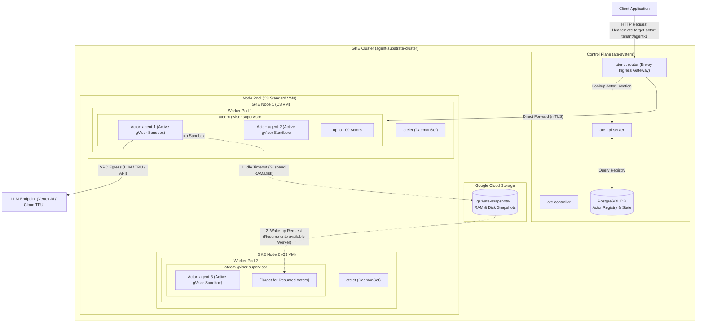
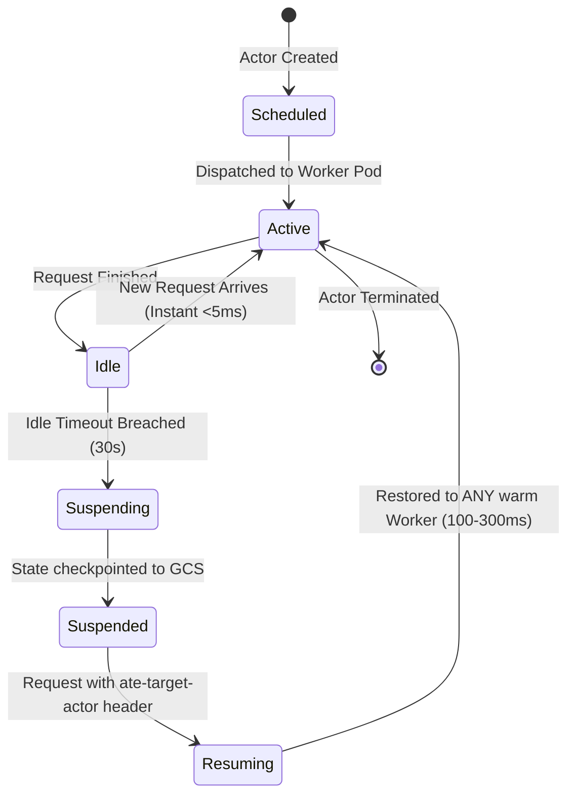

# Agent Substrate on Google Kubernetes Engine (GKE)

A comprehensive, production-grade guide, architecture reference, and manifest repository for deploying and operating **Agent Substrate on Google Kubernetes Engine (GKE)**.

[](LICENSE)
[](https://kubernetes.io/)
[](https://cloud.google.com/kubernetes-engine)
[-009688)](https://gvisor.dev/)

---

## Table of Contents
1. [What is Agent Substrate?](#what-is-agent-substrate)
2. [Why Not Just Run 1 Agent per Pod?](#why-not-just-run-1-agent-per-pod)
3. [Core Concepts & Resource Hierarchy](#core-concepts--resource-hierarchy)
4. [Architecture & Request Flow](#architecture--request-flow)
5. [Prerequisites](#prerequisites)
6. [Step-by-Step GKE Deployment](#step-by-step-gke-deployment)
   - [Phase 1: VPC & Subnet Preparation](#phase-1-vpc--subnet-preparation)
   - [Phase 2: GKE Standard Cluster Creation](#phase-2-gke-standard-cluster-creation)
   - [Phase 3: Storage & Workload Identity](#phase-3-storage--workload-identity)
   - [Phase 4: Agent Substrate Control Plane Installation](#phase-4-agent-substrate-control-plane-installation)
   - [Phase 5: Deploy WorkerPool & ComputeClass](#phase-5-deploy-workerpool--computeclass)
7. [Deploying Your First Agent (Actor)](#deploying-your-first-agent-actor)
8. [Suspend & Resume Lifecycle](#suspend--resume-lifecycle)
9. [Scaling & Sizing Formula](#scaling--sizing-formula)
10. [Production Best Practices & Pitfalls](#production-best-practices--pitfalls)
11. [Troubleshooting & Verification](#troubleshooting--verification)

---

## What is Agent Substrate?

**Agent Substrate** is a purpose-built agent execution runtime designed to run millions of stateful AI agent sandboxes with **10x to 30x higher density** than standard container runtimes.

AI agents behave very differently from traditional web services:
- **Bursty & I/O-Bound**: Agents spend 90%+ of their lifecycle waiting for LLM completions, human-in-the-loop approvals, or tool I/O.
- **Stateful Sessions**: Agents hold conversation history, tool caches, and filesystem artifacts in local RAM and scratch disks.
- **Security Sandboxing**: Agents generate and execute untrusted code (Python, Bash, SQL) requiring zero-trust kernel isolation.

Substrate bridges the gap between **Kubernetes infrastructure orchestration** and **high-density serverless micro-execution** by dynamically bin-packing hundreds of isolated gVisor (`runsc`) agent sessions ("Actors") inside warm Kubernetes Pods ("Workers").

---

## Why Not Just Run 1 Agent per Pod?

| Dimension | 1 Agent = 1 Pod (Traditional K8s) | Agent Substrate (Actors inside Worker Pods) |
| :--- | :--- | :--- |
| **Startup / Resume Latency** | **5 – 30 seconds** (Scheduling, CNI IP assignment, image pulls) | **100 – 300 milliseconds** (Workers already warm; starts sandbox process) |
| **Cluster Limits** | **Hard ceiling at 15,000 – 30,000 Pods** (etcd, kube-proxy, IPAM exhaustion) | **100,000+ to 500,000 active agents** (K8s only sees worker pool pods) |
| **Idle Cost** | **High** (Idle pods hold reserved RAM/CPU or terminate completely) | **Near zero** (Idle actors hibernate their RAM/disk snapshots to GCS) |
| **State Mobility** | **Difficult** (State locked to Pod PVC; migration requires volume re-attachment) | **Instant Teleport** (Actors resume onto *any* available worker in milliseconds) |
| **Security Isolation** | Relies on namespace or standard runc container isolation | **Kernel-level gVisor (`runsc`) sandbox** with virtualized syscalls |

---

## Core Concepts & Resource Hierarchy

Understanding the relationship between Kubernetes primitives and Substrate primitives is essential:

```
GKE Cluster
 └── Node Pool (Compute Engine VMs, e.g. C3 Sapphire Rapids)
      └── ComputeClass (Governs VM family, Shielded VM, labels)
           └── WorkerPool CRD (Manages fleet of Worker Pods)
                └── Worker (A standard Kubernetes Pod running ateom-gvisor)
                     └── In-Pod Base Container (Runtime supervisor)
                          ├── Actor 1 (gVisor runsc sandbox: Python/Tool session)
                          ├── Actor 2 (gVisor runsc sandbox: Bash session)
                          └── ... up to 100+ Actors bin-packed per Worker
```

### Definitions:
* **`Atespace`**: A multi-tenant administrative boundary or tenant workspace (analogous to a Kubernetes namespace, but for agents).
* **`ActorTemplate`**: Defines the blueprint for an agent — container base image, memory/CPU quotas, environment variables, and idle hibernation timeouts.
* **`Actor`**: A live, stateful instance of an agent running in its own gVisor sandbox.
* **`Worker`**: A single Kubernetes Pod running the `ateom-gvisor` daemon. It hosts multiple Actors simultaneously.
* **`WorkerPool`**: A Kubernetes Custom Resource that scales and manages identical Worker Pod replicas across nodes.
* **`EgressPolicy`**: Granular network policy restricting or allowing actor outbound connectivity (e.g. to Vertex AI, Cloud TPUs, or external APIs).

---

## Architecture & Request Flow



---

## Prerequisites

Before starting, ensure you have:
1. **Google Cloud SDK (`gcloud`)** version $\ge$ 480.0.0.
2. **`kubectl`** matching cluster version ($\ge$ 1.30).
3. **`kubectl-ate`** CLI plugin installed.
4. GCP IAM permissions: `roles/container.admin`, `roles/storage.admin`, `roles/iam.serviceAccountAdmin`.
5. A GCP project with billing enabled and the following APIs activated:
   ```bash
   gcloud services enable \
     container.googleapis.com \
     compute.googleapis.com \
     storage.googleapis.com \
     iam.googleapis.com
   ```

---

## Step-by-Step GKE Deployment

### Phase 1: VPC & Subnet Preparation

GKE clusters running Agent Substrate benefit from a dedicated subnet with Dataplane V2 enabled:

```bash
PROJECT_ID="your-gcp-project"
REGION="us-central1"
ZONE="us-central1-a"
VPC_NAME="agent-vpc"
SUBNET_NAME="agent-substrate-subnet"

# 1. Create VPC network (if not existing)
gcloud compute networks create ${VPC_NAME} --subnet-mode=custom

# 2. Create Subnetwork with secondary ranges for Pods and Services
gcloud compute networks subnets create ${SUBNET_NAME} \
  --network=${VPC_NAME} \
  --region=${REGION} \
  --range=10.60.0.0/20 \
  --secondary-range=agent-pods=10.70.0.0/16,agent-services=10.80.0.0/20
```

### Phase 2: GKE Standard Cluster Creation

Deploy a GKE Standard cluster with **Node Auto-Provisioning (NAP)**, **Dataplane V2**, and the required **Beta mTLS Certificate APIs**:

```bash
CLUSTER_NAME="agent-substrate-cluster"

gcloud container clusters create ${CLUSTER_NAME} \
  --zone=${ZONE} \
  --cluster-version=1.36.4-gke.2046000 \
  --network=${VPC_NAME} \
  --subnetwork=${SUBNET_NAME} \
  --enable-ip-alias \
  --cluster-secondary-range-name=agent-pods \
  --services-secondary-range-name=agent-services \
  --machine-type=c3-standard-4 \
  --num-nodes=3 \
  --enable-dataplane-v2 \
  --workload-pool=${PROJECT_ID}.svc.id.goog \
  --enable-kubernetes-unstable-apis=certificates.k8s.io/v1beta1/podcertificaterequests,certificates.k8s.io/v1beta1/clustertrustbundles \
  --enable-autoprovisioning \
  --min-cpu=1 \
  --max-cpu=64 \
  --min-memory=4 \
  --max-memory=256 \
  --enable-autoprovisioning-autorepair \
  --enable-autoprovisioning-autoupgrade \
  --enable-shielded-nodes \
  --shielded-secure-boot \
  --shielded-integrity-monitoring
```

> **Why C3 VMs?** GCE C3 machine types (Intel Sapphire Rapids) provide deterministic CPU instruction sets, which is critical for consistent memory checkpointing (`gVisor save/restore`) across different nodes.

### Phase 3: Storage & Workload Identity

Agent Substrate requires a Cloud Storage bucket for saving memory and filesystem snapshots when actors hibernate:

```bash
BUCKET_NAME="ate-snapshots-${PROJECT_ID}-${REGION}"

# 1. Create GCS bucket
gcloud storage buckets create gs://${BUCKET_NAME} \
  --location=${REGION} \
  --uniform-bucket-level-access

# 2. Grant Workload Identity permissions to atelet and ate-api-server
gcloud storage buckets add-iam-policy-binding gs://${BUCKET_NAME} \
  --member="principal://iam.googleapis.com/projects/$(gcloud projects describe ${PROJECT_ID} --format='value(projectNumber)')/locations/global/workloadIdentityPools/${PROJECT_ID}.svc.id.goog/subject/ns/ate-system/sa/atelet" \
  --role="roles/storage.objectAdmin"

gcloud storage buckets add-iam-policy-binding gs://${BUCKET_NAME} \
  --member="principal://iam.googleapis.com/projects/$(gcloud projects describe ${PROJECT_ID} --format='value(projectNumber)')/locations/global/workloadIdentityPools/${PROJECT_ID}.svc.id.goog/subject/ns/ate-system/sa/ate-api-server" \
  --role="roles/storage.objectAdmin"
```

### Phase 4: Agent Substrate Control Plane Installation

Apply the Substrate control plane manifests:

```bash
# Apply namespaces, CRDs, and controllers
kubectl apply -k manifests/ate-install/
```

Verify all control plane pods are running:
```bash
kubectl get pods -n ate-system
```
Expected output:
```
NAME                                           READY   STATUS    RESTARTS   AGE
ate-api-server-7b9c6f89b-8x2lq                 1/1     Running   0          2m
ate-controller-5df84b7f4-m9xpk                 1/1     Running   0          2m
atenet-egress-84c688d66-r2zlw                  1/1     Running   0          2m
atenet-router-69c76b9f4f-4tk2b                 1/1     Running   0          2m
atelet-d5m8x                                   1/1     Running   0          2m
atelet-x9p12                                   1/1     Running   0          2m
atelet-y8q43                                   1/1     Running   0          2m
pod-certificate-controller-74f4c9c4db-9zk5x    1/1     Running   0          2m
postgres-0                                     1/1     Running   0          2m
```

### Phase 5: Deploy WorkerPool & ComputeClass

Create the Custom ComputeClass so GKE Node Auto-Provisioning automatically provisions C3 nodes for Workers:

```yaml
# manifests/computeclass-agent-worker.yaml
apiVersion: cloud.google.com/v1
kind: ComputeClass
metadata:
  name: agent-worker-class
spec:
  nodePoolSettings:
    machineFamily: c3
    labels:
      agent-substrate.io/role: worker
    taints:
      - key: agent-substrate.io/role
        value: worker
        effect: NoSchedule
```

Create the `WorkerPool` with sizing for up to 100 actors per worker:

```yaml
# manifests/workerpool-c3.yaml
apiVersion: substrate.google.com/v1alpha1
kind: WorkerPool
metadata:
  name: c3-agent-workers
  namespace: demo-agents
spec:
  replicas: 2
  template:
    metadata:
      labels:
        agent-substrate.io/role: worker
    spec:
      tolerations:
      - key: "agent-substrate.io/role"
        operator: "Equal"
        value: "worker"
        effect: "NoSchedule"
      containers:
      - name: worker
        image: us-docker.pkg.dev/gke-substrate-release/substrate/ateom-gvisor:v0.2.0-gke.0
        resources:
          requests:
            cpu: "8"
            memory: "28Gi"
          limits:
            cpu: "12"
            memory: "32Gi"
        env:
        - name: ATEOM_MAX_ACTORS
          value: "100"
```

Apply both manifests:
```bash
kubectl apply -f manifests/computeclass-agent-worker.yaml
kubectl apply -f manifests/workerpool-c3.yaml
```

---

## Deploying Your First Agent (Actor)

### 1. Create the Tenant Space (`Atespace`)
```yaml
# manifests/demo-tenant.yaml
apiVersion: substrate.google.com/v1alpha1
kind: Atespace
metadata:
  name: demo-tenant
```

### 2. Define the Agent Template (`ActorTemplate`)
```yaml
# manifests/actortemplate-python.yaml
apiVersion: substrate.google.com/v1alpha1
kind: ActorTemplate
metadata:
  name: python-agent
  namespace: demo-tenant
spec:
  idleTimeout: "30s" # Hibernate to GCS after 30 seconds of inactivity
  resources:
    requests:
      cpu: "100m"
      memory: "256Mi"
    limits:
      cpu: "500m"
      memory: "512Mi"
  template:
    spec:
      containers:
      - name: agent
        image: python:3.11-slim
        command: ["python3", "-u", "-c"]
        args:
        - |
          import http.server, socketserver, json, os
          class Handler(http.server.SimpleHTTPRequestHandler):
              def do_POST(self):
                  length = int(self.headers.get('content-length', 0))
                  body = self.rfile.read(length).decode('utf-8')
                  resp = {"status": "ok", "echo": body, "pid": os.getpid()}
                  self.send_response(200)
                  self.send_header('Content-Type', 'application/json')
                  self.end_headers()
                  self.wfile.write(json.dumps(resp).encode('utf-8'))
          with socketserver.TCPServer(("", 8080), Handler) as httpd:
              httpd.serve_forever()
        ports:
        - containerPort: 8080
```

### 3. Create the Actor
```yaml
# manifests/actor-devops-1.yaml
apiVersion: substrate.google.com/v1alpha1
kind: Actor
metadata:
  name: devops-agent-1
  namespace: demo-tenant
spec:
  templateRef:
    name: python-agent
```

Apply:
```bash
kubectl apply -f manifests/demo-tenant.yaml
kubectl apply -f manifests/actortemplate-python.yaml
kubectl apply -f manifests/actor-devops-1.yaml
```

### 4. Send Traffic to the Actor
Routing is handled through the `atenet-router` Envoy gateway. The target actor is specified using the `ate-target-actor` header:

```bash
ROUTER_IP=$(kubectl get svc atenet-router -n ate-system -o jsonpath='{.status.loadBalancer.ingress[0].ip}')

curl -X POST http://${ROUTER_IP}:8080/ \
  -H "Host: atenet-router.ate-system.svc.cluster.local" \
  -H "ate-target-actor: demo-tenant/devops-agent-1" \
  -H "Content-Type: application/json" \
  -d '{"message": "Hello from Agent Substrate!"}'
```

---

## Suspend & Resume Lifecycle



1. **Active**: The Actor runs inside a gVisor `runsc` sandbox on Worker 1.
2. **Idle**: The turn finishes. CPU usage drops to 0, but RAM and file state remain resident.
3. **Suspending**: When `idleTimeout` (e.g. 30s) expires without traffic, `ateom` initiates a gVisor memory and disk checkpoint, streaming the snapshot bundle directly to `gs://${BUCKET_NAME}`.
4. **Suspended**: The sandbox on Worker 1 is torn down. Memory is freed for other actors. The actor consumes **\$0.00 compute**.
5. **Resume (Instant Teleport)**: A new message arrives at `atenet-router`. The router parks the HTTP connection, queries `ate-api-server`, streams the state bundle onto an available worker (e.g. Worker 2), unpauses the process at the exact memory instruction, and completes the HTTP request in **150–300ms**.

---

## Scaling & Sizing Formula

### How Many Actors per Worker?

Use the sizing formula:
$$\text{Max Actors per Worker} = \min\left( \frac{\text{Worker RAM} - \text{Overhead}}{\text{Peak Working-Set RAM per Actor}}, \; \frac{\text{Worker vCPUs} \times \text{Oversubscription Factor}}{\text{Active Compute CPU per Actor}} \right)$$

### Sizing Cheat Sheet:

| Workload Type | RAM / Actor | CPU Usage Profile | Target Density | Worker Pod Sizing |
| :--- | :--- | :--- | :--- | :--- |
| **Conversational / TAM Agent** (API calls, tool I/O) | 64 – 128 MiB | Ultra-low (95% I/O wait) | **150 – 250 actors** | 4 vCPU, 16–32 GB RAM |
| **DevOps / Script Execution** (bash, git, curl, jq) | 256 MiB | Moderate bursts | **80 – 100 actors** | 8 vCPU, 32 GB RAM |
| **Data Analysis Agent** (Python, pandas, duckdb) | 512 MiB – 1 GiB | High compute bursts | **25 – 50 actors** | 8–16 vCPU, 32–64 GB RAM |

### How an Actor Surge Triggers a Compute Node
1. **Saturation**: Existing Worker Pods reach memory limit or `ATEOM_MAX_ACTORS`.
2. **WorkerPool Scaling**: HPA or Substrate autoscaler creates new Worker Pods.
3. **Pending State**: If existing nodes lack capacity, the new Worker Pods enter `Pending (Unschedulable)`.
4. **Node Auto-Provisioning (NAP)**: Detects pending pods with `ComputeClass/agent-worker-class` and calls GCE APIs to spin up new `c3-standard-4` VMs.
5. **Pod Binding**: Once the VM joins the cluster, the Worker Pod starts, and actors resume immediately.

---

## Production Best Practices & Pitfalls

### 1. Homogeneous CPU Architectures
> [!IMPORTANT]
> Always pin your Worker node pools to a homogeneous CPU family (e.g. exclusively Google Compute Engine **C3** Intel Sapphire Rapids). 
> Restoring a gVisor memory snapshot taken on an Intel CPU onto an AMD (or older Intel) node can cause CPU instruction set mismatches (`SIGILL` Illegal Instruction).

### 2. Private Clusters & Shielded VMs
- Ensure `--enable-private-nodes` is enabled.
- Enforce `--shielded-secure-boot` and `--shielded-integrity-monitoring` to comply with enterprise Org Policies.

### 3. Dedicated Secondary IP Ranges
- Avoid running out of Pod IPs. For high-density setups, ensure your Pod secondary subnet CIDR is at least `/16` (65,536 IPs).

### 4. Granular Egress Policies
- Agents generating arbitrary code must never have unrestricted access to VPC internal services. Use Substrate `EgressPolicy` CRDs to whitelist only required endpoints (e.g., Cloud TPU port 8000, Vertex AI, or specific internet APIs).

### 5. Idle Timeout Tuning
- Set `idleTimeout: "30s"` to `"60s"` for interactive multi-turn chat applications to avoid thrashing snapshots between closely spaced user turns.
- Set `idleTimeout: "10s"` for batch or background agents to immediately reclaim worker memory.

---

## Troubleshooting & Verification

### Helpful Commands:
```bash
# Check status of Substrate control plane
kubectl get pods -n ate-system

# Check active workers and their allocated actor density
kubectl ate get workers

# Check status of registered actors
kubectl ate get actors -n demo-tenant

# Stream logs from a specific actor
kubectl ate logs devops-agent-1 -n demo-tenant -f

# Force suspend an actor manually
kubectl ate suspend devops-agent-1 -n demo-tenant

# Force resume an actor manually
kubectl ate resume devops-agent-1 -n demo-tenant
```

---

## License
Apache License 2.0. See [LICENSE](LICENSE) for details.
